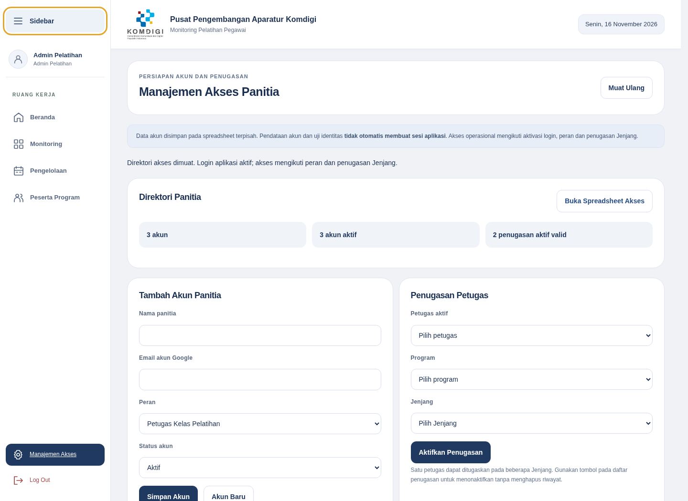
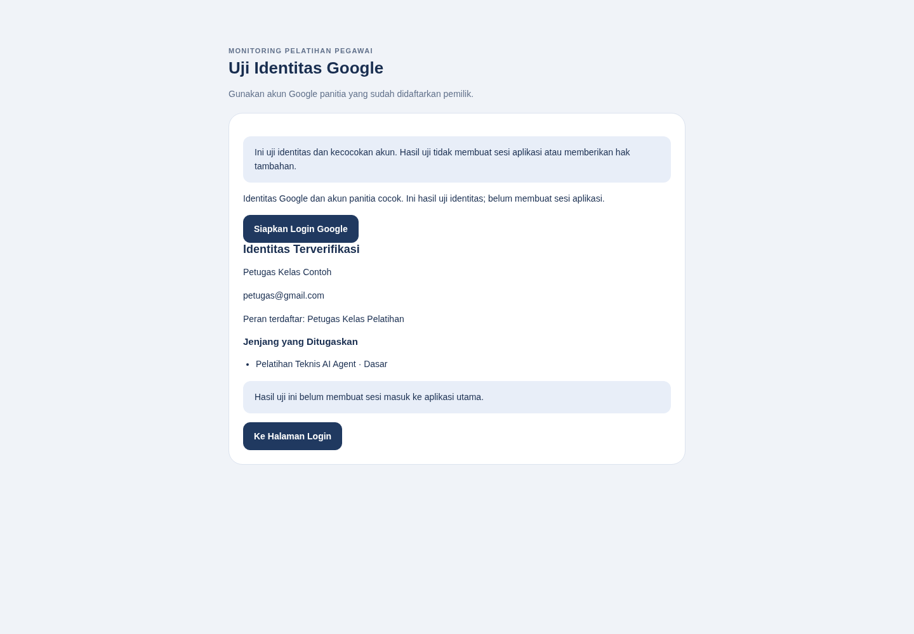

# Revisi Manajemen Akses dan tombol login

16 November 2026 — perubahan pada **Akses.gs** saja.

## Hasil

- Keterangan **Pengelola: nama/email** di bawah judul Manajemen Akses Panitia dihapus, pada web dan panel spreadsheet yang memakai sumber tampilan yang sama.
- Setelah Uji Identitas Google berhasil, tersedia tombol **Ke Halaman Login**. Tombol mengarah ke URL deployment yang tersimpan dalam konfigurasi, ditambah `?page=masuk`, di tab yang sama.
- Tombol tampil ketika login aplikasi telah diaktifkan. Hasil uji tetap berupa verifikasi identitas; login biasa diperlukan untuk membuat sesi aplikasi.

Email pada keterangan sebelumnya berasal dari akun yang lolos pemeriksaan akses: admin yang sedang masuk pada web, atau pemilik pada panel spreadsheet. Tidak ada alamat email pribadi yang ditulis permanen pada keterangan itu.

## Pemasangan

1. Buka [Akses.gs lengkap](https://github.com/DNA0604/for-training-recap/blob/fix/akses-tombol-login/apps-script/absensi-dashboard/Akses.gs), lalu pilih **Raw** dan salin seluruh isinya.
2. Pada proyek Apps Script yang digunakan, ganti seluruh isi berkas **Akses.gs** dan simpan.
3. Buka **Deploy → Manage deployments → Edit**, pilih versi baru, lalu perbarui deployment yang sama agar URL aplikasi tetap.

Tidak perlu membuat sheet, mengulang pendaftaran akun, atau mengubah konfigurasi OAuth. Berkas aplikasi lainnya tetap memakai versi yang sudah terpasang. Tidak ada perubahan pada aturan sesi, peran, penugasan atau struktur data.

## Uji setelah pemasangan

1. Buka Manajemen Akses dengan akun Admin: keterangan Pengelola di bawah judul sudah hilang; Muat Ulang dan direktori tetap bekerja.
2. Jalankan uji identitas pada tab yang sama sampai berhasil. Tombol **Ke Halaman Login** muncul di bawah hasil uji.
3. Klik tombol dan pastikan menuju halaman masuk pada deployment yang sama. Lanjutkan login dengan akun yang terdaftar.

Pengujian lokal: 100 tes akses/login lulus; browser desktop/ponsel mencakup panel native/web, hasil uji berhasil/gagal, tombol sebelum/sesudah verifikasi, URL konfigurasi yang berbeda dari URL otomatis, klik navigasi dan tidak terciptanya sesi melalui uji identitas. Pemeriksaan sintaks sumber dan ID HTML juga lulus. Layanan Google menggunakan data tiruan; deployment nyata belum diuji atau diperbarui oleh asisten.

## Pratinjau lokal

Semua gambar memakai data simulasi.

[Pratinjau ponsel](../previews/revisi-akses-login/Uji-Berhasil-Mobile.png)
