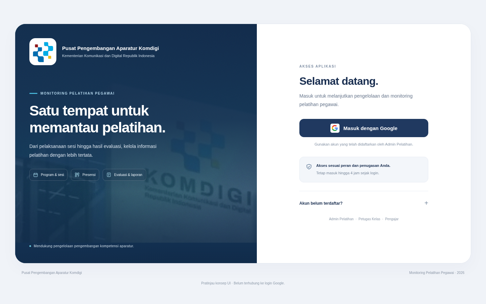

# Konsep halaman awal login — 9 November 2026

**Status: konsep dan pratinjau UI, belum diintegrasikan.** Pengguna meminta merancang konsep serta UI terlebih dahulu. Folder ini bukan paket pengganti Apps Script. Tidak ada file aplikasi, konfigurasi, akun, spreadsheet atau deployment yang diubah. Branch `design/konsep-login-awal` melanjutkan `a39f828`.



[Pratinjau ponsel](login-mobile.png) · [Prototipe HTML lokal](index.html)

## Arah desain

Satu halaman sambutan sekaligus login, dengan tampilan formal dan hangat mengikuti navy/putih dashboard. Desktop memakai dua panel dalam bingkai membulat: kiri memperkenalkan instansi dan fungsi aplikasi; kanan memberi satu tindakan utama **Masuk dengan Google**. Foto gedung diberi lapisan navy melalui CSS agar teks tetap terbaca. Pada ponsel panel disusun vertikal; judul/pengantar dipersingkat secara visual dan tombol login tetap mudah ditemukan.

Isi panel pengenalan:

- Logo dan nama Pusat Pengembangan Aparatur Komdigi.
- Identitas Kementerian Komunikasi dan Digital Republik Indonesia.
- Nama aplikasi **Monitoring Pelatihan Pegawai**.
- Judul **“Satu tempat untuk memantau pelatihan.”**
- Gambaran singkat Program & Sesi, Presensi, serta Evaluasi & Laporan. Label fitur adalah informasi, bukan tautan yang memberi akses sebelum login.

Isi kartu login:

- Sapaan Selamat datang dan penjelasan singkat tujuan login.
- Satu tombol Masuk dengan Google; tanpa form email/kata sandi kedua.
- Petunjuk menggunakan akun yang sudah didaftarkan Admin Pelatihan.
- Catatan bahwa akses mengikuti peran/penugasan dan sesi maksimal empat jam sejak login.
- Bantuan ringkas “Akun belum terdaftar?” yang menyarankan menghubungi Admin, bukan pendaftaran akun publik.
- Nama tiga peran sebagai informasi, bukan pilihan peran.

Tidak ditambahkan akun demo, statistik palsu, pemilihan jabatan/peran, fitur pendaftaran mandiri atau tombol untuk melewati login. Animasi cukup untuk indikator proses; tidak memakai animasi latar berat atau font/CDN eksternal.

## Alur yang harus dipertahankan jika nanti diterapkan

1. Periksa sesi tersimpan dengan server sebagaimana sistem sekarang.
2. Sesi masih sah di bawah empat jam: lanjutkan ke halaman tujuan yang diizinkan, tanpa meminta klik Google atau menampilkan halaman sambutan sebagai penghalang tambahan.
3. Sesi tidak ada/kedaluwarsa: tampilkan desain login ini dengan tombol Google aktif setelah alur login siap.
4. User klik Google; proses verifikasi akun serta peran tetap menggunakan backend saat ini. Identitas atau kewenangan tidak ditentukan dari tampilan.
5. Akun tidak terdaftar, perubahan akun, akses ditahan/ditolak dan gangguan jaringan tetap mempunyai pesan/tindakan sesuai alur yang sudah ada. Teks contoh pada prototipe perlu disesuaikan dengan keadaan server saat implementasi.

Pratinjau menyediakan lima keadaan visual: awal login, memeriksa sesi, sesi masih aktif, akun belum terdaftar dan koneksi bermasalah. Tombol Google di prototipe hanya menampilkan keadaan memeriksa; tidak menghubungi Google atau masuk ke aplikasi. Bagian “Lihat contoh keadaan tampilan” di bawah halaman adalah kontrol peninjauan desain, bukan bagian dari rancangan produk final.

## Aset dan ketergantungan

Logo dan foto gedung diekstrak tanpa perubahan piksel dari `asetLaporan_()` pada LaporanTampilan.gs, berasal dari DOCX yang diberikan pengguna. SHA-256 sesuai `../laporan-template/ASSETS.json`:

- `logo-komdigi.png`: `53d63f5e5eacbce7eca95d9a27ecfa57aca46f43b8efb15ee00cb0ee236ad4c7` (6.006 byte).
- `gedung-komdigi.jpg`: `b1b98b84a395acc35dc863d79b790b0052e27507062a622e07328878cdd02164` (440.017 byte).

Gambar asli tidak diedit/digenerasikan ulang; pemotongan/warna panel hanya melalui tata letak CSS. Seluruh aset prototipe lokal, font memakai sistem yang sejalan dengan dashboard. Jika dipilih untuk produksi, pemuatan foto harus tidak menahan pemeriksaan sesi atau tombol login; foto boleh diganti/dikurangi setelah peninjauan desain dan ukuran aset. Jangan menganggap pratinjau ini sudah mengatasi waktu pemuatan deployment.

## Melihat prototipe secara lokal

Buka `index.html` melalui server statis lokal. Contoh dari root repositori:

```bash
python -m http.server 8765 --bind 127.0.0.1 --directory apps-script/absensi-dashboard/previews/konsep-login-awal
```

Akses `http://127.0.0.1:8765/`. Gunakan pilihan keadaan di bagian bawah atau parameter `?state=checking`, `?state=remembered`, `?state=unregistered`, `?state=error` untuk melihat contoh lain. GitHub blob/Raw menampilkan kode HTML, bukan layanan hosting untuk prototipe; gambar PNG di atas dapat dilihat langsung tanpa menjalankan apa pun.

Pratinjau diperiksa pada Chromium di **1440×900, 390×900 dan 320×740**: logo termuat, tombol jelas, tidak ada overflow horizontal, bantuan/keadaan visual dapat dipilih, tidak ada error JavaScript, serta seluruh permintaan hanya ke server lokal (tidak ada OAuth/RPC/analitik eksternal). Tidak ada klaim pengujian login nyata atau deployment Google dari pekerjaan konsep ini.

Untuk tahap berikutnya, pengguna meninjau komposisi, judul, penggunaan foto dan isi kartu. Kode login produksi baru diubah setelah arah desain diminta untuk diterapkan. Perubahan ini tidak merupakan penerimaan otomatis terhadap paket UI atau pemuatan sebelumnya.
