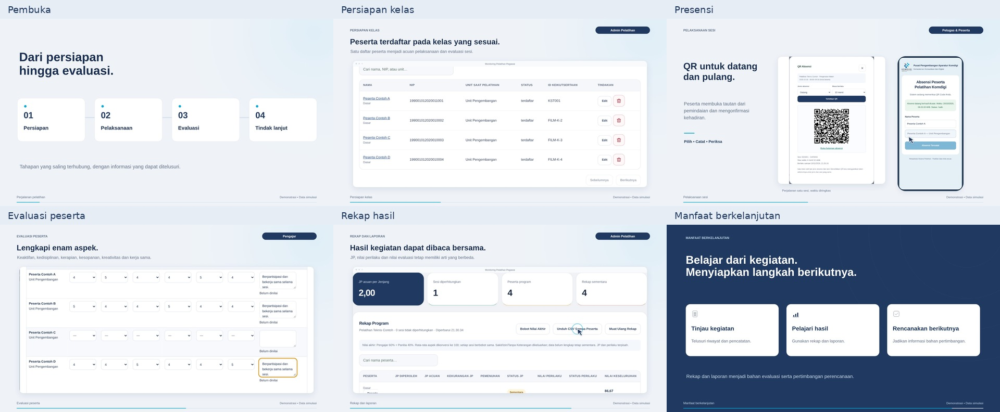

# Video dengan musik dan efek — Monitoring Pelatihan Pegawai

Video mengikuti satu program pelatihan dari persiapan hingga evaluasi dan pemanfaatan hasilnya. **Durasi 4 menit 8 detik, Full HD 1920 × 1080, 30 fps.** Intro delapan detik yang telah disetujui dipertahankan.

**[Putar / unduh Video_Dashboard_Musik_Efek.mp4](https://github.com/DNA0604/for-training-recap/blob/video/musik-efek-suara/apps-script/absensi-dashboard/video-promosi/film/Video_Dashboard_Musik_Efek.mp4?raw=true)**

Sesuai keputusan terbaru pengguna, **tanpa narasi suara**. Musik instrumental asli **Perjalanan Tertata**, tempo 96 BPM, mengiringi animasi dan teks. Ada 22 efek ringan pada pembuka/penutup, perpindahan bab dan beberapa interaksi. Musik masuk perlahan, berubah kepadatan mengikuti alur dan mereda pada penutup. Visual dan seluruh frame intro tetap identik dengan versi visual yang telah dibuat.

Komposisi dan efek disintesis dari kode untuk proyek ini; tidak memakai rekaman lagu, sampel stok atau suara narator. [Rencana musik, titik efek dan pengaturan campuran](RENCANA_AUDIO.json) dapat disunting. Trek musik, efek, dan campuran tersedia terpisah di folder [audio](audio/). Campuran AAC stereo 48 kHz: hasil pengukuran sekitar **−18,3 LUFS**, true peak **−2,3 dBTP**, tanpa clipping. Penilaian kenyamanan musik/efek tetap melalui pratinjau pengguna.



## Bagian video

| Waktu | Isi |
| --- | --- |
| 00:00–00:08 | Intro tiga logo asli, sesuai pratinjau yang disetujui |
| 00:08–00:33 | Perjalanan pelatihan dan informasi yang perlu dipantau |
| 00:33–00:58 | Pengenalan dashboard dan peran |
| 00:58–01:33 | Persiapan program, kelas dan peserta |
| 01:33–02:13 | Presensi QR/manual, izin dan pemantauan |
| 02:13–02:53 | Evaluasi Pengajar/Panitia dan catatan perilaku |
| 02:53–03:28 | Perhitungan JP, rekap, CSV dan laporan |
| 03:28–03:53 | Riwayat dan manfaat berkelanjutan |
| 03:53–04:08 | Penutup |

Animasi memakai teks bergerak, kartu alur, pergantian peran, pergerakan kamera, penunjuk interaksi, serta tampilan aplikasi saat ini. Tangkapan UI mengikuti akses Admin, Petugas Kelas dan Pengajar. Bahan laporan berasal dari renderer laporan aplikasi yang sama, dirender lokal untuk ilustrasi.

## Satu contoh yang konsisten

Program **Pelatihan Teknis Contoh → Dasar → Pengenalan Materi** mempunyai empat peserta simulasi:

- A: presensi QR datang/pulang, JP 2.
- B: manual Terlambat, potongan tetap 15 menit, JP 75/45 ≈ 1,67.
- C: manual Izin satu sesi penuh, JP 0, evaluasi berstatus tidak dinilai.
- D: manual Hadir/Tepat Waktu, JP 2.

Pengajar mengisi enam aspek; Panitia mengisi kedisiplinan, kerja sama dan prakarsa setelah sesi berakhir. Catatan kejadian, JP dan nilai evaluasi merupakan sumber/hasil berbeda. Admin meninjau verifikasi, menghitung JP dan membuka laporan untuk program selesai. Video tidak menetapkan kelulusan atau menampilkan fitur AI/prediksi.

## Menggunakan dan menyunting

- [Unduh paket pemutar HTML dan sumber visual](https://github.com/DNA0604/for-training-recap/blob/video/musik-efek-suara/apps-script/absensi-dashboard/video-promosi/film/Paket_Sumber_Film.zip?raw=true)
- [Timeline yang dapat disunting](TIMELINE.json)
- [Animasi dan komposisi Canvas](film.js)
- [HTML pemutar](player.html)
- [Teks penjelas opsional](Teks_Penjelas_Indonesia.srt)
- [Pembuat komposisi dan efek](buat_audio.py)
- [Pemeriksaan suara dan kesamaan visual](PEMERIKSAAN_AUDIO.json)
- [Metadata sumber UI](SUMBER_UI.json)
- [Hasil pemeriksaan film](PEMERIKSAAN_FILM.json)

Ekstrak paket, lalu buka `film/player.html`. Klik **Putar** untuk memulai gambar dan suara bersama. Kontrol menyediakan putar/jeda, ulangi, penggeser waktu, pilihan bab, teks penjelas opsional dan tombol bisukan. Pemutar menunggu interaksi pengguna agar sesuai aturan audio browser. Teks penjelas bukan rekaman narasi; MP4 hanya memuat teks visual utama, musik dan efek. Kontrol berada di luar komposisi video dan tidak direkam. Pemutar tidak melakukan login Google, membaca spreadsheet atau mengirim perubahan data.

Bila browser membatasi pembukaan berkas lokal, jalankan `python film/serve_preview.py` dari folder hasil ekstraksi, lalu buka `http://127.0.0.1:8000/film/player.html`. Server lokal ini mendukung permintaan sebagian berkas (HTTP Range) agar audio tetap tepat saat melompat waktu.

Untuk membuat ulang audio dan paket dari repository dengan dependensi yang tersedia:

```bash
python apps-script/absensi-dashboard/video-promosi/film/buat_data.py
python apps-script/absensi-dashboard/video-promosi/film/buat_audio.py
python apps-script/absensi-dashboard/video-promosi/film/periksa_film.py
python apps-script/absensi-dashboard/video-promosi/film/periksa_audio.py
python apps-script/absensi-dashboard/video-promosi/film/buat_paket.py
```

Pembuat audio memerlukan numpy, scipy dan FFmpeg. Berkas WAV sementara berada di `/tmp/dashboard-audio/`; versi kompresi musik/efek/campuran dan MP4 disimpan di folder ini. Video H.264 disalin langsung dari `Pratinjau_Dashboard_Lengkap.mp4`, tanpa render ulang visual. `render_film.py` hanya diperlukan bila sengaja mengganti animasi visual. Paket ZIP berisi pemutar, aset asli dan campuran suara; MP4 diunduh terpisah. Naskah Word dan `Narasi_Indonesia.srt` lama dipertahankan sebagai arsip perencanaan, bukan rencana produksi suara yang masih tertunda.

Pengambilan ulang UI memakai `ambil_ui.py` dan `fixture-film.mjs`, dengan backend aplikasi lokal dan layanan Google tiruan. QR historis serta tanda terima publik merupakan data simulasi; penyimpanan manual, penilaian, verifikasi dan perhitungan JP diperoleh melalui handler backend lokal asli. Semua gambar memakai data fiktif. Sumber aplikasi tetap `7dacfb0`; tidak ada pengujian atau perubahan pada data Google/deployment.

Untuk mereproduksi halaman laporan, fixture menulis DOCX contoh ke `/tmp/film-laporan-contoh.docx`. Renderer aplikasi menyusun dokumennya; LibreOffice lokal dipakai membuat gambar sampul dan hasil. Ilustrasi lokal ini tidak membuktikan keberhasilan ekspor Google Docs pada deployment.

Video dengan musik dan efek ini siap untuk **ditinjau pengguna**. Narasi suara tidak termasuk sesuai arahan terbaru. Semua 19 sumber aplikasi, tiga panduan Word dan berkas intro yang telah disetujui tetap utuh. Branch main tidak diubah.
