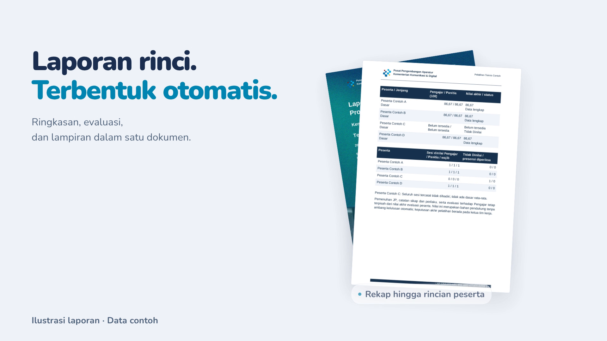

# Satu Pintu — Dashboard Pelatihan

Versi uji coba baru: **45 detik · Full HD 1920×1080 · 30 fps · musik dan efek ringan · tanpa narasi suara.**

**[Putar / unduh MP4](https://github.com/DNA0604/for-training-recap/blob/video/uji-coba-dashboard-45-detik/apps-script/absensi-dashboard/video-promosi/uji-coba-45-detik/Dashboard_Pelatihan_45_Detik.mp4?raw=true)**



## Isi video

| Waktu | Adegan |
| --- | --- |
| 00:00–00:05 | Banyak aktivitas pelatihan menyatu dalam satu dashboard |
| 00:05–00:10 | Akses dengan akun Google yang terdaftar |
| 00:10–00:16,25 | Ringkasan pemantauan dan navigasi Monitoring |
| 00:16,25–00:23,75 | Penghitungan JP: contoh 90 menit efektif menjadi 2 JP |
| 00:23,75–00:30 | Pencatatan aktivitas, waktu, bukti, dan status |
| 00:30–00:38,75 | Tombol Buat PDF, sampul dan halaman laporan rinci |
| 00:38,75–00:45 | Satu pintu. Pelatihan lebih tertata. |

Animasi memakai panel yang menyatu, kamera mendekati antarmuka, cursor pada kontrol asli, pergantian angka menit ke JP, penelusuran catatan, dan dokumen yang muncul setelah klik. Palet navy–putih mengikuti dashboard, dengan aksen cyan pada pesan utama.

Tampilan berasal dari aset aplikasi yang sudah tersedia pada branch `video/musik-efek-suara`, commit `0189ab1`. Seluruh data operasional yang diperlihatkan adalah **data contoh**, bukan akses ke akun atau spreadsheet Google. Label, tombol, dan laporan mengikuti sumber aplikasi. Cuplikan laporan adalah ilustrasi lokal; bukan bukti pengujian ekspor Google pada deployment.

Musik menggunakan potongan instrumental **Perjalanan Tertata** yang telah ada di repository ini. Efek klik/perpindahan ringan berasal dari paket Hyperframes media-use berlisensi Pixabay. Asal aset dan hash dicatat di [SUMBER_ASET.json](SUMBER_ASET.json).

## Sumber yang dapat disunting

- [index.html](index.html): komposisi utama dan trek audio.
- [compositions](compositions): tujuh adegan dengan timeline GSAP masing-masing.
- [build.py](build.py): sumber generator komposisi; jalankan setelah mengubahnya.
- [TIMELINE.json](TIMELINE.json): urutan, waktu, dan durasi.
- [SPEC.md](SPEC.md): arah visual dan batas klaim.
- [REVIEW.md](REVIEW.md): hasil tinjauan dan keterbatasan.
- [PEMERIKSAAN.json](PEMERIKSAAN.json): hasil validasi berkas ekspor.

Dengan Node 22+, FFmpeg dan Chromium/Chrome yang tersedia:

```bash
cd apps-script/absensi-dashboard/video-promosi/uji-coba-45-detik
python3 build.py
npx --yes hyperframes@0.9.52 check
npx --yes hyperframes@0.9.52 preview --background
npx --yes hyperframes@0.9.52 render --quality delivery --fps 30 --workers 2 -o Dashboard_Pelatihan_45_Detik.mp4
python3 finalize.py
```

Di environment cloud sesi ini, `./run.sh` memakai tool lokal yang sudah terpasang dan cache yang bisa ditulis; misalnya `./run.sh check` atau `./run.sh preview --background --port 3017`.

`finalize.py` menyesuaikan level audio ke sekitar −16 LUFS tanpa mengubah stream H.264, memeriksa 1.350 frame dan decode audio/video lengkap, lalu menulis PEMERIKSAAN.json. Gunakan `npx ... check --json > check-final.log` bila ingin menyertakan hasil pemeriksaan komposisi dalam catatan tersebut.

Ini proyek video terpisah. **Tidak ada berkas HTML/GS aplikasi yang perlu diganti**, dan tidak ada deployment, data Google, video empat menit sebelumnya, atau branch `main` yang diubah.
